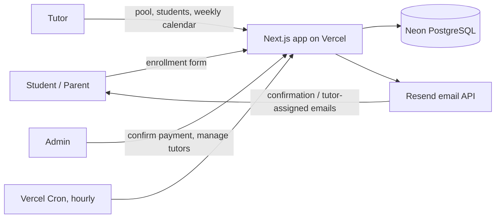
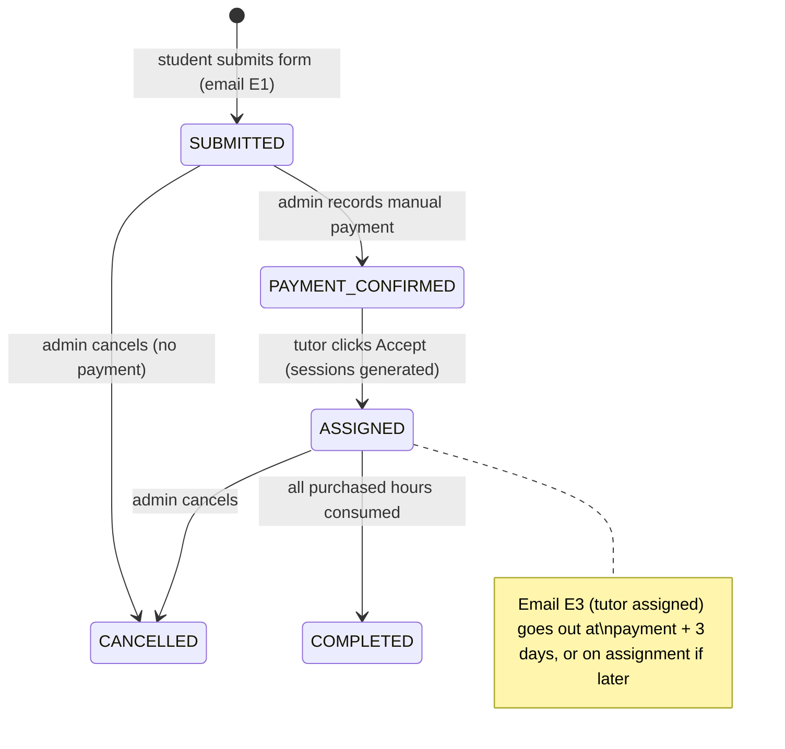

# Tutoring Center Enrollment System: Project Plan

Status: Planning phase, v0.1 (1 October 2026)
Owner: Web developer (contractor)
Client: Tutoring center

## How this plan is organised

| File | What it covers |
|---|---|
| `00-README.md` | This overview, key decisions at a glance, system diagrams |
| `01-architecture-and-stack.md` | Architecture pattern, language, framework, database hosting, deployment, environments, file structure |
| `02-requirements-and-business-rules.md` | Functional requirements per role, the hours/schedule validation rules, session status and hours accounting |
| `03-data-model-and-api.md` | Database schema, internal API endpoints, external services, email catalogue |
| `04-milestones.md` | Daily milestones with testable outcomes and the test-then-deploy pipeline every milestone goes through |
| `05-open-questions.md` | Items the brief leaves unclear, each with a proposed default so work isn't blocked |

## Key decisions at a glance

| Decision | Choice | One-line reason |
|---|---|---|
| Architecture | Layered (Presentation → API → Service → Repository → DB) plus a pure Domain layer | Scheduling/hours rules are the riskiest logic; isolating them makes them unit-testable without a database |
| Language | TypeScript (end to end) | One language for UI, API and validation; the same validation code runs in the browser and on the server |
| Framework | Next.js (App Router) with React | Full-stack in one project, one deployment, first-class Vercel support |
| Database | PostgreSQL on Neon (serverless Postgres) | Managed, free tier for dev, a database branch per pull request for safe testing |
| ORM | Prisma | Typed queries, versioned migrations |
| Auth | Auth.js (email magic link) for tutors and admin; students do not log in | No passwords to manage; students get a reference code instead |
| Email | Resend + React Email templates | Simple API, good deliverability, templates written as components |
| Scheduled jobs | Vercel Cron (hourly) | Drives the "tutor assigned" email 3 days after payment |
| Calendar UI | FullCalendar (time-grid week view) | Mature week view with click handlers for add/cancel |
| Hosting / deploy | Vercel (Pro plan, since this is commercial use) | Preview deployment per pull request, production on merge to `main` |
| CI | GitHub Actions | Lint, type-check, unit, integration, E2E gates before any deploy |
| Testing | Vitest (unit/integration), Playwright (E2E, with a controllable clock) | Time-dependent features (ongoing/completed colors, 3-day email) need a fake clock |

## Roles

1. Student / parent (public, no login): submits an enrollment request.
2. Tutor (logged in): browses unassigned students, accepts them, manages their weekly schedule.
3. Admin / center staff (logged in): an added role, not in the brief. Payment is manual, so someone at the center has to mark an enrollment as paid; that event starts the 3-day email clock. Admin also manages the tutor list and the subject list. See open question Q1.

## System overview

## Enrollment lifecycle

## Scope

In scope for v1: everything in the brief, plus the minimal admin screens needed to record payment and manage tutors/subjects.

Out of scope for v1 (candidates for later): online payment, invoices, student logins, automatic conflict resolution between overlapping students, SMS notifications, reporting dashboards, payroll for tutors.
