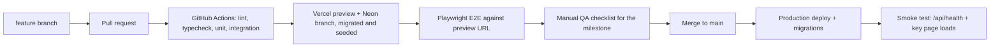

# 01: Architecture and Technology Stack

## 1. Architecture pattern: Layered, with a pure Domain core

I considered three options:

| Option | Verdict |
|---|---|
| Classic MVC monolith (e.g. Laravel or Django) | Perfectly viable. Rejected mainly because the calendar UI is highly interactive, which pushes toward a React front end anyway, and running two stacks adds cost. |
| Separate SPA + REST backend (two deployables) | More moving parts than a small center needs. |
| **Layered full-stack app in Next.js (chosen)** | One codebase and one deployment, with clear internal boundaries. |

### Layers and rules

```
┌──────────────────────────────────────────────┐
│ Presentation  (src/app pages, src/components)│  React UI, forms, calendar
├──────────────────────────────────────────────┤
│ API           (src/app/api/**/route.ts)       │  HTTP only: auth check, parse with Zod, call a service, map errors
├──────────────────────────────────────────────┤
│ Service       (src/server/services)           │  Use cases: submitEnrollment, acceptStudent, cancelSession…
├──────────────────────────────────────────────┤
│ Repository    (src/server/repositories)       │  All Prisma/SQL lives here, nowhere else
├──────────────────────────────────────────────┤
│ Database      (Neon PostgreSQL)               │
└──────────────────────────────────────────────┘
        ▲ used by Service layer AND by the browser
┌──────────────────────────────────────────────┐
│ Domain        (src/domain)                    │  Pure TypeScript, no I/O, no dates from the system clock:
│                                              │  schedule validation, session generation,
│                                              │  session status, hours ledger
└──────────────────────────────────────────────┘
```

Rules enforced in code review (and by an ESLint `no-restricted-imports` rule):

1. API route handlers never import Prisma directly.
2. The Domain layer imports nothing from `server/`, `app/` or any I/O library, and receives "now" as a parameter instead of calling `new Date()`. This is what makes the ongoing/completed logic and the hours rules testable.
3. Validation schemas (Zod) live in `src/schemas` and are shared by the form (instant feedback) and the API (authoritative check). The server never trusts the client's result.

## 2. Language and libraries

| Concern | Choice |
|---|---|
| Language | TypeScript (strict mode) |
| Framework | Next.js (App Router), React |
| Styling / components | Tailwind CSS + shadcn/ui |
| Forms | React Hook Form + Zod resolver |
| Weekly calendar | FullCalendar `timeGridWeek` (core is MIT-licensed) |
| Dates and time zones | date-fns + date-fns-tz. All timestamps stored in UTC; displayed in the center's time zone (configurable) |
| ORM / migrations | Prisma |
| Auth | Auth.js (NextAuth v5), email magic-link provider, Prisma adapter |
| Email | Resend + React Email |
| Spam protection on the public form | Cloudflare Turnstile + a honeypot field + rate limiting |
| Rate limiting | Upstash Redis rate limiter (free tier) on public endpoints |
| Error monitoring | Sentry (free tier) |
| Testing | Vitest, Testing Library, Playwright |

## 3. Database hosting: Neon PostgreSQL

Why Neon:
- Managed Postgres with a free tier for development.
- Database branching: every pull request gets its own copy of the schema and seed data, so E2E tests run against an isolated database and can't damage production.
- Point-in-time restore on paid plans, which matters once real enrollments and payment records are stored.
- The official Vercel integration creates a branch for each preview deployment automatically.

Alternative if the client prefers: Supabase Postgres. The schema and Prisma code would not change.

Data-protection notes: the system stores minors' names and guardians' phone numbers and emails. Choose the Neon region closest to the center, enable a consent checkbox on the form, and follow local data-privacy law (see Q18 in open questions).

## 4. Deployment: Vercel

| Environment | Trigger | Database | Purpose |
|---|---|---|---|
| Local | `pnpm dev` | Postgres in Docker (`docker compose up`) | Development |
| Preview | Every pull request | Neon branch created per PR, seeded | Automated E2E + manual QA by client |
| Production | Merge to `main` after all gates pass | Neon `main` branch | Live system |

Notes:
- Vercel's Hobby plan is restricted to non-commercial use and limits cron frequency, so production needs the Pro plan. Check current pricing with the client before launch.
- Custom domain (e.g. `enroll.<center-domain>`) and the sending domain for Resend (SPF/DKIM records) should be set up during the first week so email deliverability is tested early.
- Secrets (`DATABASE_URL`, `RESEND_API_KEY`, `AUTH_SECRET`, `CRON_SECRET`, `TURNSTILE_SECRET`) live in Vercel environment variables, separated per environment. Never committed.
- Rollback: Vercel "Instant Rollback" to the previous production deployment; migrations are written to be backward-compatible (expand, then contract) so a rollback doesn't break against the newer schema.

## 5. CI/CD pipeline (applies to every milestone)



A milestone is only merged when every gate is green. Features that are deployed but not yet meant for real users (for example the tutor calendar before the accept flow exists) are hidden behind a feature flag read from an environment variable.

## 6. Project file structure

```
tutoring-enrollment/
├── .github/workflows/
│   ├── ci.yml                     # lint, typecheck, unit, integration
│   └── e2e.yml                    # Playwright against the Vercel preview URL
├── prisma/
│   ├── schema.prisma
│   ├── migrations/
│   └── seed.ts                    # tutors, offerings (subjects, CET, HSET), sample enrollments
├── emails/                        # React Email templates
│   ├── EnrollmentReceived.tsx
│   ├── PaymentConfirmed.tsx
│   ├── TutorAssigned.tsx
│   └── AdminUnassignedAlert.tsx
├── src/
│   ├── app/
│   │   ├── (public)/
│   │   │   ├── page.tsx                       # landing page
│   │   │   └── enroll/
│   │   │       ├── page.tsx                   # multi-step enrollment form
│   │   │       └── success/page.tsx           # shows reference code
│   │   ├── login/page.tsx                     # magic-link login (tutor/admin)
│   │   ├── tutor/
│   │   │   ├── layout.tsx                     # tutor nav, role guard
│   │   │   ├── pool/page.tsx                  # card view of unassigned students
│   │   │   ├── students/page.tsx              # my students list
│   │   │   ├── students/[enrollmentId]/page.tsx  # detail + edit recurring schedule
│   │   │   └── schedule/page.tsx              # weekly calendar
│   │   ├── admin/
│   │   │   ├── enrollments/page.tsx           # confirm payments, see status
│   │   │   ├── tutors/page.tsx
│   │   │   └── offerings/page.tsx
│   │   └── api/
│   │       ├── health/route.ts
│   │       ├── auth/[...nextauth]/route.ts
│   │       ├── public/
│   │       │   ├── tutors/route.ts
│   │       │   ├── offerings/route.ts
│   │       │   └── enrollments/{route.ts, preview/route.ts}
│   │       ├── tutor/
│   │       │   ├── pool/{route.ts, [id]/route.ts, [id]/accept/route.ts}
│   │       │   ├── students/{route.ts, [id]/route.ts, [id]/schedule/route.ts}
│   │       │   └── sessions/{route.ts, [id]/route.ts}
│   │       ├── admin/
│   │       │   ├── enrollments/{route.ts, [id]/confirm-payment/route.ts}
│   │       │   ├── tutors/route.ts
│   │       │   └── offerings/route.ts
│   │       └── cron/assignment-emails/route.ts
│   ├── components/
│   │   ├── ui/                    # shadcn primitives
│   │   ├── enrollment/            # StepDetails, StepProgram, StepSchedule, StepReview
│   │   ├── pool/                  # StudentCard, StudentDetailDialog
│   │   └── calendar/              # WeekCalendar, SessionDialog, AddSessionDialog, StatusLegend
│   ├── domain/                    # PURE: no I/O, "now" passed in
│   │   ├── schedule/validate.ts   # weekly load vs purchased hours, slot rules
│   │   ├── schedule/generate.ts   # slots + start date + hours -> session list
│   │   ├── sessions/status.ts     # UPCOMING | ONGOING | COMPLETED | CANCELLED
│   │   └── hours/ledger.ts        # purchased, completed, scheduled, unscheduled, overage
│   ├── server/
│   │   ├── services/              # enrollment, payment, pool, session, schedule, notification
│   │   ├── repositories/          # one per aggregate, Prisma only here
│   │   ├── email/                 # Resend client + send wrapper with EmailLog
│   │   └── auth/                  # Auth.js config, requireRole()
│   ├── schemas/                   # Zod schemas shared by client and server
│   ├── lib/                       # db.ts, env.ts (validated env vars), time.ts, errors.ts, flags.ts
│   └── middleware.ts              # protects /tutor/* and /admin/*
├── tests/
│   ├── unit/                      # domain tests (the bulk of the test suite)
│   ├── integration/               # services + real Postgres
│   └── e2e/                       # Playwright specs, one folder per milestone
├── docker-compose.yml             # local Postgres
├── vercel.json                    # cron schedule
├── .env.example
└── README.md
```
