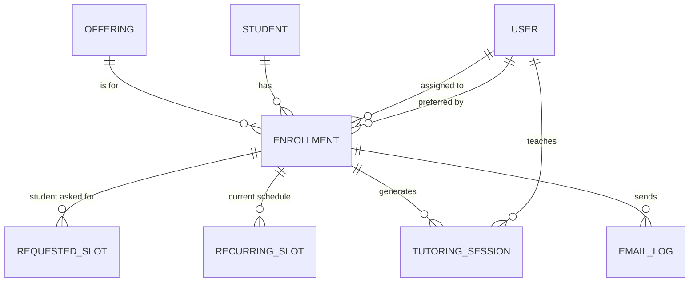

# 03: Data Model and APIs

## 1. Entity overview



Two separate slot tables on purpose: `RequestedSlot` keeps exactly what the family asked for (never edited), while `RecurringSlot` is the live schedule the tutor can change. This keeps a record of the original request if there's ever a dispute.

The tutoring-session table is named `TutoringSession` because Auth.js's Prisma adapter already uses a model called `Session` for login sessions.

## 2. Prisma schema (draft)

```prisma
enum Role              { TUTOR ADMIN }
enum OfferingCategory  { SUBJECT CET HSET }
enum Cadence           { WEEKLY BIWEEKLY }
enum EnrollmentStatus  { SUBMITTED PAYMENT_CONFIRMED ASSIGNED COMPLETED CANCELLED }
enum SessionSource     { GENERATED MAKEUP ADDITIONAL }
enum SessionStatus     { SCHEDULED CANCELLED }   // upcoming/ongoing/completed are computed from time
enum EmailType         { ENROLLMENT_RECEIVED PAYMENT_CONFIRMED TUTOR_ASSIGNED ADMIN_UNASSIGNED_ALERT }
enum EmailStatus       { QUEUED SENT FAILED }

model User {
  id          String   @id @default(cuid())
  email       String   @unique
  name        String
  phone       String?
  role        Role
  active      Boolean  @default(true)
  createdAt   DateTime @default(now())
  preferredBy Enrollment[]       @relation("PreferredTutor")
  assigned    Enrollment[]       @relation("AssignedTutor")
  sessions    TutoringSession[]
  // + Auth.js relations (accounts, sessions)
}

model Offering {
  id          String           @id @default(cuid())
  name        String           // "Algebra", "Chemistry", "CET Review", "HSET Review"
  category    OfferingCategory
  active      Boolean          @default(true)
  sortOrder   Int              @default(0)
  enrollments Enrollment[]
}

model Student {
  id               String   @id @default(cuid())
  firstName        String
  lastName         String
  email            String
  phone            String
  gradeLevel       String
  school           String?
  isMinor          Boolean
  guardianName     String?
  guardianRelation String?
  guardianEmail    String?
  guardianPhone    String?
  consentAt        DateTime
  createdAt        DateTime @default(now())
  enrollments      Enrollment[]
  @@index([email])
}

model Enrollment {
  id                   String           @id @default(cuid())
  referenceCode        String           @unique
  studentId            String
  offeringId           String
  notes                String?
  purchasedHours       Decimal          @db.Decimal(5, 1)
  cadence              Cadence
  startDate            DateTime         @db.Date
  preferredTutorId     String?
  tutorId              String?
  status               EnrollmentStatus @default(SUBMITTED)
  submittedAt          DateTime         @default(now())
  paymentConfirmedAt   DateTime?
  paymentConfirmedById String?
  paymentAmount        Decimal?         @db.Decimal(10, 2)
  paymentReference     String?
  assignedAt           DateTime?
  tutorEmailSentAt     DateTime?
  adminAlertSentAt     DateTime?

  student        Student           @relation(fields: [studentId], references: [id])
  offering       Offering          @relation(fields: [offeringId], references: [id])
  preferredTutor User?             @relation("PreferredTutor", fields: [preferredTutorId], references: [id])
  tutor          User?             @relation("AssignedTutor", fields: [tutorId], references: [id])
  requestedSlots RequestedSlot[]
  recurringSlots RecurringSlot[]
  sessions       TutoringSession[]
  emails         EmailLog[]

  @@index([status, tutorId])
  @@index([preferredTutorId, status])
}

model RequestedSlot {
  id           String @id @default(cuid())
  enrollmentId String
  dayOfWeek    Int    // 1 = Monday … 7 = Sunday (ISO)
  startMinute  Int    // minutes after midnight, center time zone
  endMinute    Int
  enrollment   Enrollment @relation(fields: [enrollmentId], references: [id], onDelete: Cascade)
}

model RecurringSlot {
  id            String   @id @default(cuid())
  enrollmentId  String
  dayOfWeek     Int
  startMinute   Int
  endMinute     Int
  effectiveFrom DateTime @db.Date
  enrollment    Enrollment @relation(fields: [enrollmentId], references: [id], onDelete: Cascade)
}

model TutoringSession {
  id            String        @id @default(cuid())
  enrollmentId  String
  tutorId       String
  startsAt      DateTime      // UTC
  endsAt        DateTime      // UTC
  lesson        String
  source        SessionSource
  status        SessionStatus @default(SCHEDULED)
  createdById   String?
  createdAt     DateTime      @default(now())
  cancelledAt   DateTime?
  cancelledById String?
  cancelReason  String?
  enrollment    Enrollment    @relation(fields: [enrollmentId], references: [id])
  tutor         User          @relation(fields: [tutorId], references: [id])

  @@index([tutorId, startsAt])
  @@index([enrollmentId, status])
}

model EmailLog {
  id           String      @id @default(cuid())
  enrollmentId String?
  type         EmailType
  to           String[]
  status       EmailStatus @default(QUEUED)
  providerId   String?
  error        String?
  attempts     Int         @default(0)
  createdAt    DateTime    @default(now())
  sentAt       DateTime?
  enrollment   Enrollment? @relation(fields: [enrollmentId], references: [id])
  @@unique([enrollmentId, type])   // guarantees each email type is sent once per enrollment
}

model AuditLog {
  id        String   @id @default(cuid())
  actorId   String?
  action    String   // "session.cancel", "session.add", "schedule.edit", "payment.confirm", "pool.accept"
  entity    String
  entityId  String
  before    Json?
  after     Json?
  createdAt DateTime @default(now())
  @@index([entity, entityId])
}

model Setting {
  key   String @id   // "timezone", "operatingHours", "paymentInstructions", "maxHours"…
  value Json
}
```

## 3. Internal API (Next.js route handlers)

All request bodies are validated with Zod. Errors use one format: `{ "error": { "code": "SCHEDULE_EXCEEDS_HOURS", "message": "...", "fields": {...} } }`.

### Public (no login)

| Method | Path | Purpose | Notes |
|---|---|---|---|
| GET | `/api/health` | Uptime + database check | Used by smoke tests |
| GET | `/api/public/tutors` | Active tutors for the dropdown | Returns `id` and display name only, no contact details |
| GET | `/api/public/offerings` | Subjects, CET, HSET grouped by category | |
| POST | `/api/public/enrollments/preview` | Validate a schedule and return the generated session list | Same domain code as the browser; rate-limited |
| POST | `/api/public/enrollments` | Submit enrollment | Turnstile token required; returns `{ referenceCode }`; triggers E1 |

### Tutor (role TUTOR)

| Method | Path | Purpose | Notes |
|---|---|---|---|
| GET | `/api/tutor/pool` | `{ requestedMe: Card[], others: Card[] }` | Only PAYMENT_CONFIRMED, unassigned |
| GET | `/api/tutor/pool/:enrollmentId` | Full detail incl. contact details and requested slots | |
| POST | `/api/tutor/pool/:enrollmentId/accept` | Accept a student | Atomic: `updateMany where tutorId = null and status = PAYMENT_CONFIRMED`; 0 rows updated → `409 ALREADY_ASSIGNED`. Generates sessions in the same transaction |
| GET | `/api/tutor/students` | My students with hours ledger | `?status=active|completed` |
| GET | `/api/tutor/students/:enrollmentId` | Detail + recurring slots + session history | 404 if not this tutor's student |
| PUT | `/api/tutor/students/:enrollmentId/schedule` | Replace recurring slots from `effectiveFrom` | Regenerates future GENERATED sessions only; returns the new ledger and any over-hours warning |
| GET | `/api/tutor/sessions?weekStart=YYYY-MM-DD&includeCancelled=false` | Sessions for one week | |
| POST | `/api/tutor/sessions` | Add make-up / additional session | Body: `enrollmentId, date, startTime, endTime, lesson, source` |
| DELETE | `/api/tutor/sessions/:id` | Cancel a session (soft delete) | Optional `reason`; allowed for past, ongoing and future sessions; writes audit log |

### Admin (role ADMIN)

| Method | Path | Purpose |
|---|---|---|
| GET | `/api/admin/enrollments?status=&q=` | List / search |
| POST | `/api/admin/enrollments/:id/confirm-payment` | `amount, reference, paidAt` → PAYMENT_CONFIRMED |
| POST | `/api/admin/enrollments/:id/cancel` | Cancel enrollment |
| POST | `/api/admin/enrollments/:id/release` | Unassign tutor, return to pool, cancel future sessions |
| GET/POST/PATCH | `/api/admin/tutors` | Manage tutors |
| GET/POST/PATCH | `/api/admin/offerings` | Manage subjects / CET / HSET |
| GET/PUT | `/api/admin/settings` | Time zone, operating hours, payment instructions |

### Cron

| Method | Path | Schedule | Purpose |
|---|---|---|---|
| GET | `/api/cron/assignment-emails` | Hourly (`vercel.json`) | Sends E3 for enrollments that are assigned and at least 3 days past payment; sends E4 to admin for unassigned ones past 3 days; retries failed emails (max 5 attempts). Protected by `Authorization: Bearer CRON_SECRET`. Idempotent thanks to the unique `(enrollmentId, type)` constraint on EmailLog. |

## 4. External services

| Service | Used for | Plan for this project |
|---|---|---|
| Vercel | Hosting, preview deployments, cron | Pro (commercial use) |
| Neon | PostgreSQL, per-PR database branches | Free tier for dev; paid tier for production backups / point-in-time restore |
| Resend | Transactional email | Free tier likely enough at launch; verify the center's sending domain (SPF, DKIM) |
| Auth.js | Magic-link login for tutors and admin | Open source, sends links through Resend |
| Cloudflare Turnstile | Bot protection on the enrollment form | Free |
| Upstash Redis | Rate limiting public endpoints | Free tier |
| Sentry | Error monitoring | Free tier |
| GitHub + Actions | Code hosting, CI | Free tier |

Pricing and free-tier limits change, so confirm current figures with the client before launch.

## 5. Email catalogue

| Code | Name | To | When | Contents |
|---|---|---|---|---|
| E1 | Request received | Student + guardian | Immediately on submit | Reference code, program, hours, requested schedule, preferred tutor (if any), payment instructions |
| E2 | Payment confirmed (optional, see Q12) | Student + guardian | When admin confirms payment | Amount received, "your tutor will be confirmed within 3 days" |
| E3 | Your tutor | Student + guardian | Payment + 3 days, once assigned (BR-20) | Tutor name, contact method, first session date/time, full session list for the first weeks |
| E4 | Unassigned student alert | Admin | Payment + 3 days with no tutor | Student, program, preferred tutor, link to admin page |
| — | Login link | Tutor / admin | On login request | Magic link (Auth.js) |
